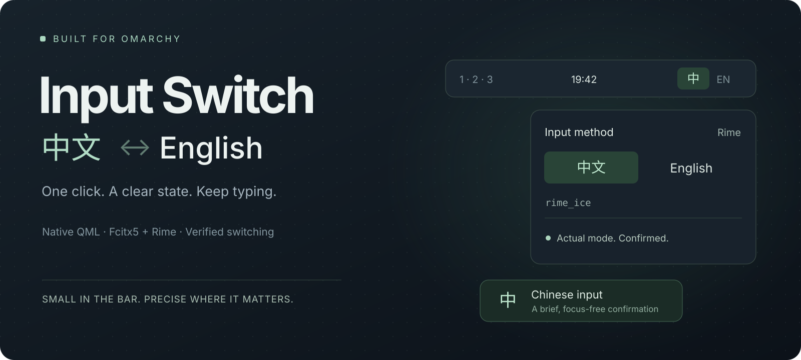
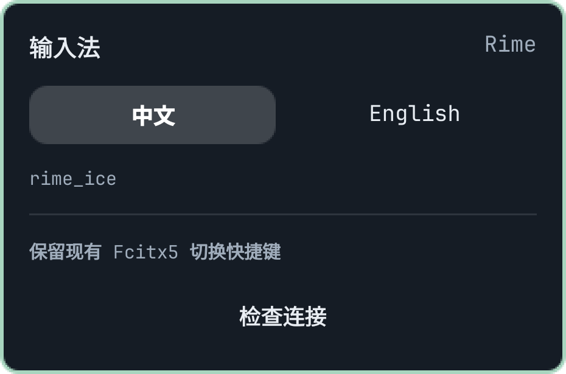
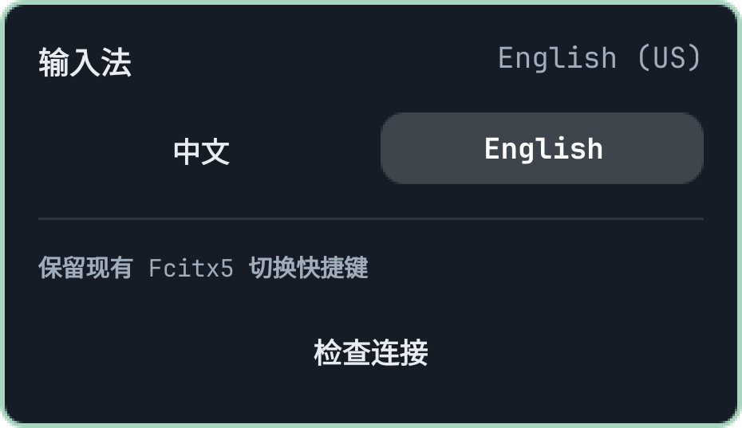
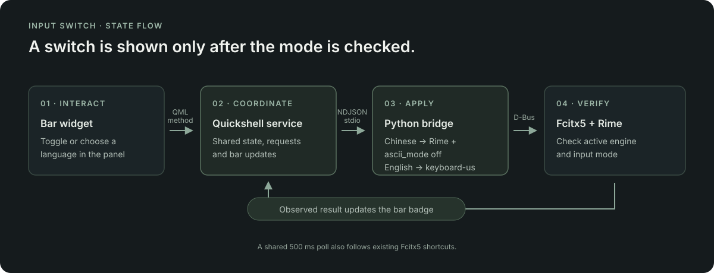

<p align="center">
  
</p>

<p align="center">
  <a href="https://omarchy.org"></a>
  
  
  <a href="LICENSE"></a>
</p>

<p align="center"><b>English</b> · <a href="README.zh-CN.md">简体中文</a></p>

**A compact, native Chinese/English input switcher for Omarchy.** Click the bar badge to switch, select a language directly from the panel, and get a brief confirmation without interrupting your typing.

Input Switch checks both the Fcitx5 engine and Rime’s internal ASCII mode. Being on the `rime` engine alone is not enough to label your input Chinese.

## See it in action

<table>
  <tr><th width="50%">Chinese · Rime</th><th width="50%">English · US keyboard</th></tr>
  <tr>
    <td align="center" valign="top"></td>
    <td align="center" valign="top"></td>
  </tr>
</table>

*These previews render the actual QML component with sample states and a sample theme. The installed plugin follows your Omarchy colors, fonts and spacing.*

## What makes it useful

- **One click to switch.** A small `中` / `EN` badge, with direct language selection a right-click away.
- **The actual mode, confirmed.** Chinese selects Rime and clears `ascii_mode`; English explicitly selects `keyboard-us`. The label updates from the observed result.
- **Your shortcuts stay yours.** Existing Fcitx5 shortcuts keep working. Changes made elsewhere are picked up by one shared 500ms poll.
- **A quiet confirmation.** A short OSD appears on the active screen without taking keyboard focus or blocking clicks.
- **One shared backend.** All bar instances use the same service and persistent D-Bus connection. Connection failures trigger retries, with backoff.
- **Honest about uncertainty.** Unknown Rime submodes display `RIME`; unavailable services display `!`. An unverified result never becomes a fake Chinese indicator.

| Badge | Meaning |
| :---: | --- |
| `中` | Rime Chinese mode is confirmed |
| `EN` | English input is confirmed, including Rime’s internal English mode |
| `RIME` | Rime is selected, but its submode cannot be confirmed |
| `…` | A request is being processed |
| `!` | The input service is unavailable |

## Install

### Requirements

- Omarchy’s **Quickshell plugin system**; Python 3 and `python-dbus`.
- A running **Fcitx5**, with **`keyboard-us` and `rime` in the same input-method group**.
- For confirmed Chinese switching, the runtime `org.fcitx.Fcitx.Rime1` interface must expose `GetCurrentSchema`, `IsAsciiMode` and `SetAsciiMode`.

Tested on Omarchy **4.0.6-1**, Quickshell **0.3.2.r7.g2b4501a-1**, Fcitx5 **5.1.23-1** and fcitx5-rime **5.1.16-1**. Capabilities are detected at runtime; the same version on another distribution may expose different interfaces.

Install missing packages only:

```bash
omarchy pkg add python-dbus fcitx5 fcitx5-rime
```

Choose **one** of the following installation methods.

### Omarchy plugin manager

```bash
omarchy plugin add https://github.com/chivopic/omarchy-input-switcher --enable
```

The badge is added to the center section of the bar. Move it if you prefer:

```bash
omarchy bar move io.github.chivopic.input-switch --section right
```

Update or remove a plugin-manager installation with:

```bash
omarchy plugin update io.github.chivopic.input-switch
omarchy plugin remove io.github.chivopic.input-switch
```

### Local checkout / development

```bash
git clone https://github.com/chivopic/omarchy-input-switcher.git
cd omarchy-input-switcher

./scripts/input-switch --doctor
./scripts/install --dry-run
./scripts/install
```

The local installer copies the plugin to `~/.config/omarchy/plugins/io.github.chivopic.input-switch/` and inserts its badge after the existing keyboard-layout widget. It preserves other settings and makes a backup before each change. Re-run `./scripts/install` after editing; use `./scripts/uninstall` to remove this installation.

Backups live in `~/.config/omarchy/input-switch-backups/`. The installer refuses to overwrite a same-name checkout it does not manage. It does not edit `/usr/share/omarchy/`, Hyprland keybindings or your Rime scheme.

## Use it

| Action | Result |
| --- | --- |
| Left-click the badge | Toggle Chinese / English |
| Right-click the badge | Open the language panel |
| Middle-click the badge | Check the connection again |
| Select 中文 / English in the panel | Close the panel, then apply the language |
| Use an existing Fcitx5 shortcut | Keep its behavior; the badge follows the result |

The plugin registers no extra shortcuts by default. `EN` describes the input mode, not Caps Lock.

Set these options on the plugin’s bar entry in `~/.config/omarchy/shell.json`:

```json
{
  "id": "io.github.chivopic.input-switch",
  "showOsd": true,
  "osdDuration": 700
}
```

`osdDuration` is in milliseconds, clamped to 250–3000ms. Set `showOsd` to `false` for a bar-only experience.

## CLI and desktop integration

From a local checkout:

```bash
./scripts/input-switch --status
./scripts/input-switch --set zh
./scripts/input-switch --set en
./scripts/input-switch --toggle
```

With the plugin enabled, talk to the shared service:

```bash
omarchy-shell input-switch status
omarchy-shell input-switch set zh
omarchy-shell input-switch set en
omarchy-shell input-switch toggle
omarchy-shell shell toggle io.github.chivopic.input-switch
```

IPC returns `queued` when a request is accepted and `busy` when another request is in progress. Check `status` for the final `state`, `pending` and `error` fields; acceptance is not confirmation.

## How it works



The Python bridge uses `asyncio` and `dbus-python`. It reuses one D-Bus connection instead of spawning `fcitx5-remote` for every refresh. A shared 500ms fallback poll catches external changes; unavailable services back off up to 10 seconds between retries.

The bridge reads engine and mode metadata. It does not read input text, candidate words or window titles. No pip install, Node runtime or custom C++ addon is needed to run the plugin.

## Troubleshooting and current scope

| Symptom | What to check |
| --- | --- |
| `!` badge | Run `./scripts/input-switch --doctor` from the checkout, or inspect `omarchy-shell input-switch status`. Check that Fcitx5 is running in the same desktop session. |
| `RIME`, with Chinese unavailable | Your Rime build may not expose the precise mode API. Check `preciseRime` in the status; the plugin will not guess. |
| A switch is not confirmed | Focus an input field and retry. A missing context or Rime maintenance can make the submode unreadable. |
| External shortcuts update the badge slightly later | The fallback poll runs every 500ms. It is separate from request verification. |

This first version focuses on **manual switching**. Per-application rules, application-specific memory and editor-mode integration are not implemented. Multi-screen sharing is implemented, but dual-monitor hardware and every GTK/Qt/Chromium/Electron input-field flow have not been individually validated.

## Development

```bash
python3 -m unittest discover -s tests -p 'test_*.py' -v
node tests/model.test.cjs
omarchy plugin validate .
```

The suite currently includes **19 Python tests**, display-model checks, an independent Wayland QML smoke test, and opt-in real desktop round trips. See the [development guide](docs/DEVELOPMENT.md) for desktop tests, the bridge protocol and reproducible native previews; see [validation notes](VALIDATION.md) for what has actually been checked.

Issues and pull requests are welcome. Include your Omarchy/Fcitx5/Rime versions and relevant status output when reporting a problem.

## Acknowledgments

Built on [Omarchy’s plugin system](https://omarchy.org/manual/shell-plugins/) and [Fcitx5](https://fcitx-im.org/wiki/DBus_Interface), with [Rime](https://github.com/fcitx/fcitx5-rime) for Chinese input. The initial design also drew on [hypr-input-switcher](https://github.com/icyleaf/hypr-input-switcher) and [im-select.nvim](https://github.com/keaising/im-select.nvim).

Released under the [MIT License](LICENSE).
