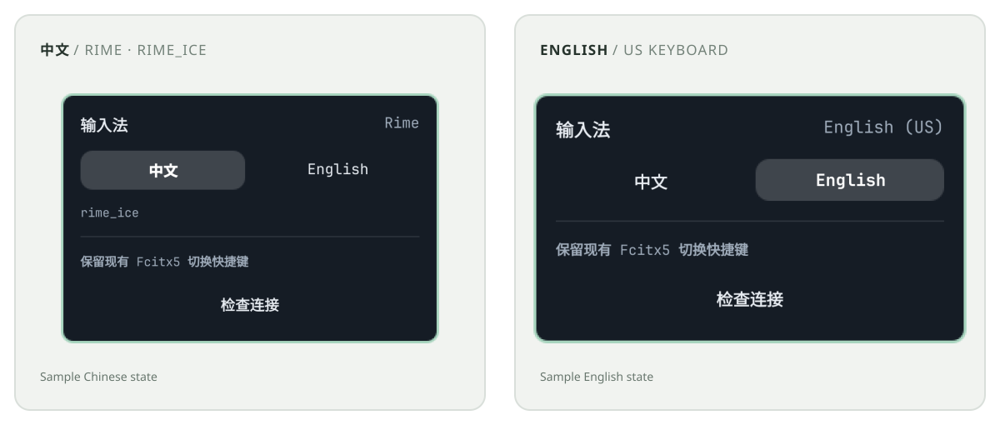

# Input Switch

为 Omarchy 顶部栏提供中英文切换：中文使用 Fcitx5 + Rime，英文明确切换到 `keyboard-us`。左键切换，右键直接选择语言，原有 Fcitx5 快捷键继续可用。

[English](README.md) · [使用与配置](docs/USAGE.zh-CN.md) · [开发指南](docs/DEVELOPMENT.md)

## 安装

```bash
omarchy plugin add https://github.com/chivopic/omarchy-input-switcher --enable
```

需要 Omarchy Quickshell 插件体系、带 `python-dbus` 的 Python 3，以及同一输入法组中的 Fcitx5 `rime` 和 `keyboard-us`。其他安装方式与完整依赖见[使用指南](docs/USAGE.zh-CN.md#依赖与安装)。

## 中英文切换



*这是实际 QML 组件使用示例状态和示例主题渲染的预览，不是桌面截图。安装后会跟随 Omarchy 主题。*

## 功能

- 左键切换，右键打开中文/英文选择面板，中键检查连接。
- 通过 Rime 模式接口确认中文，英文明确选择 `keyboard-us`。徽标表示已观察到的状态，而非仅根据当前引擎推断。
- 保留现有 Fcitx5 快捷键；共享的 500ms 查询会同步插件外的切换。
- 短暂 OSD 不会抢键盘焦点；所有顶部栏实例共用一个 Python D-Bus 服务。
- Rime 模式未知时显示 `RIME`；服务断开时显示 `!`。

桥接只读取引擎和模式元数据，不读取输入文本、候选词或窗口标题。插件运行不需要 pip 或 Node。请求与状态确认流程见[开发指南](docs/DEVELOPMENT.md#state-flow)。

## 当前范围

当前版本支持手动切换，尚未实现按应用规则或编辑器模式联动。多屏共享机制已实现，但双屏硬件以及 GTK、Qt、Chromium、Electron 中的各类输入流程尚未逐一验证。

精确确认中文模式需要运行时 `org.fcitx.Fcitx.Rime1` 接口提供 `GetCurrentSchema`、`IsAsciiMode`、`SetAsciiMode`。插件会检测接口能力；模式未知时不会猜测。请见[故障排查](docs/USAGE.zh-CN.md#故障排查)和[验证记录](VALIDATION.md)。

## 项目

[MIT 许可证](LICENSE) · [反馈问题](https://github.com/chivopic/omarchy-input-switcher/issues) · [开发指南](docs/DEVELOPMENT.md)
